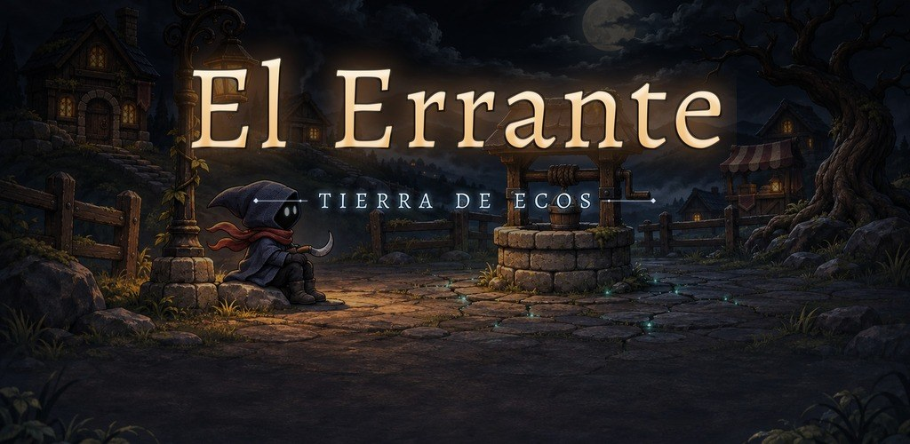
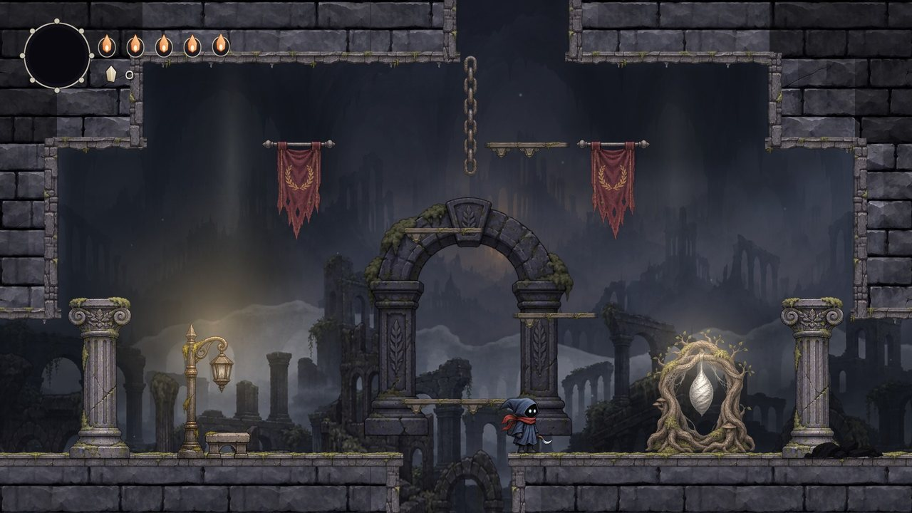
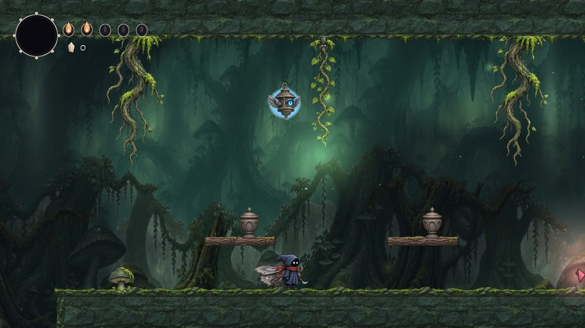
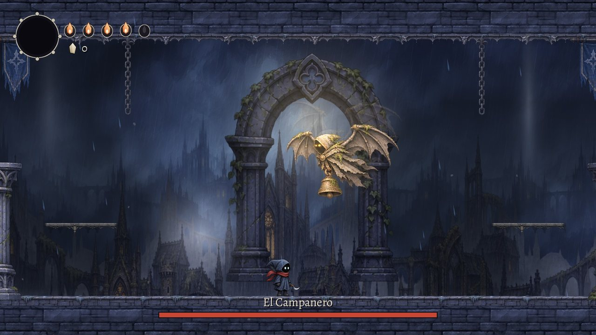
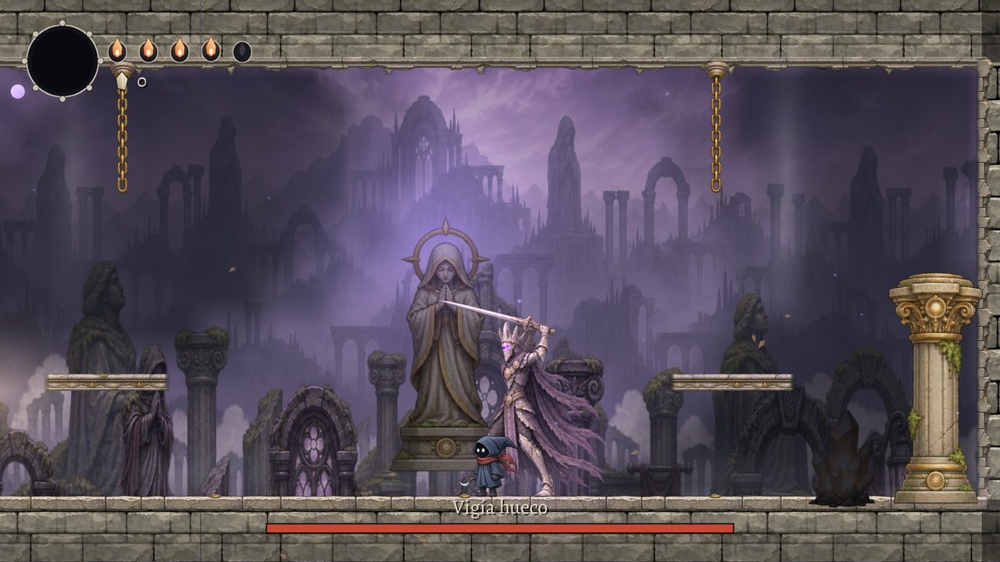

  

<h1 align="center">El Errante: Tierra de Ecos</h1>

  Metroidvania 2D de cuento oscuro · Android, Android TV, Fire TV y Windows 
  <b>Gratis, sin anuncios, sin compras y sin conexión · 11 idiomas</b>

  <a href="https://nombrote.github.io/el_errante/">Web del juego</a> ·
  <a href="https://github.com/nombrote/el_errante/releases/latest">Descargar la última versión</a> ·
  <a href="https://nombrote.github.io/el_errante/privacidad.html">Política de privacidad</a>

  
  &nbsp;
  

---

Bajo la aldea de **Pozoalto** se abre un mundo hundido. **El Errante**, un pequeño viajero encapuchado con su hoz,
baja por el pozo para descubrir qué queda ahí abajo.

Un metroidvania en la línea de Hollow Knight: exploración, combate exigente y un mundo hundido lleno de secretos.

<table>
  <tr>
    <td width="50%"></td>
    <td width="50%"></td>
  </tr>
  <tr>
    <td></td>
    <td></td>
  </tr>
</table>

## Descargas

En [Releases](https://github.com/nombrote/el_errante/releases/latest):

| Archivo | Para |
|---|---|
| `ElErrante-Android.apk` | Teléfono, tableta, Android TV y Fire TV (Android 5 o superior) |
| `ElErrante-Windows.zip` | Windows 10 y 11 (descomprimir y abrir `ElErrante.exe`) |

**Android:** abre el APK en el teléfono y, si lo pide, permite instalar aplicaciones desde el navegador.
**Fire TV:** instala la app «Downloader», permítele instalar apps desconocidas y descarga el APK desde ella.
**Windows:** si SmartScreen avisa, «Más información» → «Ejecutar de todas formas».

## El juego

- Seis zonas y 59 salas conectadas, con atajos, muros secretos y salas escondidas.
- Salto variable, impulso, doble salto y garra; cada habilidad abre caminos nuevos.
- Combate con la hoz, jefes con varias fases, emblemas y vendedores escondidos.
- Cooperativo para dos jugadores con mando.
- Pantalla táctil, mando o mando de la tele.
- Español, English, Français, Deutsch, Italiano, Português, Русский, 日本語, 한국어, 中文, Polski.

## Apoya el juego

El Errante es gratis y lo seguirá siendo, sin anuncios ni compras. Si te ha gustado y quieres ayudar a que siga
creciendo, puedes [invitarme a un café](https://paypal.me/nombrote) ☕

## Hecho con ayuda de Chati.AI

El código, las herramientas que dibujan el mundo y las traducciones se hicieron con
[**Chati.AI**](https://github.com/nombrote/chati.ai), un agente de inteligencia artificial gratuito para el
ordenador: tiene cara y voz, habla contigo, programa, maneja archivos y el navegador, y funciona con modelos en
tu PC o en la nube. [Web de Chati.AI](https://nombrote.github.io/chati.ai/)

 

---

## English

*El Errante: Land of Echoes* is a dark fairy-tale 2D metroidvania for Android, Android TV, Fire TV and Windows.
Free, no ads, no purchases, no internet needed, in 11 languages.
A metroidvania in the vein of Hollow Knight: exploration, demanding combat and a sunken world full of secrets.
Download it from [Releases](https://github.com/nombrote/el_errante/releases/latest) or visit the
[game's website](https://nombrote.github.io/el_errante/).

Made with the help of [Chati.AI](https://github.com/nombrote/chati.ai), a free AI agent for your computer.
If you enjoyed it, you can [buy me a coffee](https://paypal.me/nombrote) ☕

---

Este repositorio solo contiene las versiones publicadas y la web del juego; el código no es público.
Un juego de Miguel González Pérez (Santander) y Chati.AI, con Claude. Todos los derechos reservados.
Hollow Knight es una marca de Team Cherry; El Errante es un juego independiente y original, sin relación con ellos.
